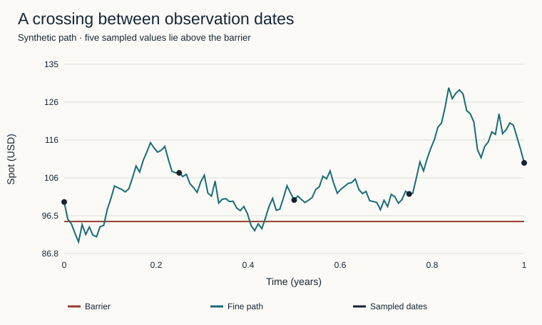
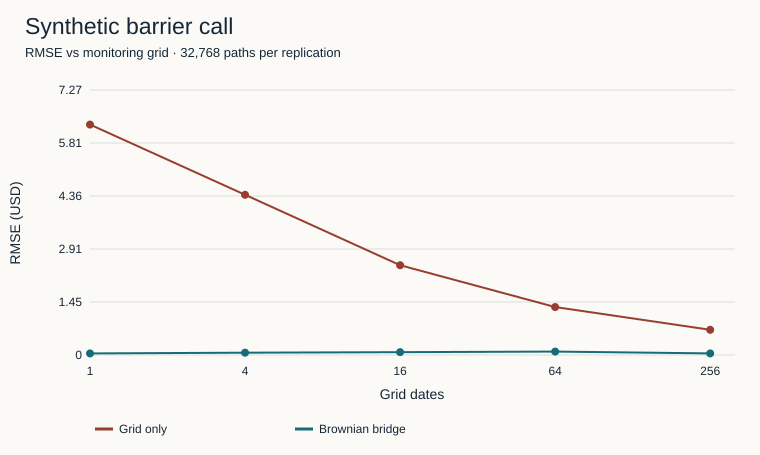
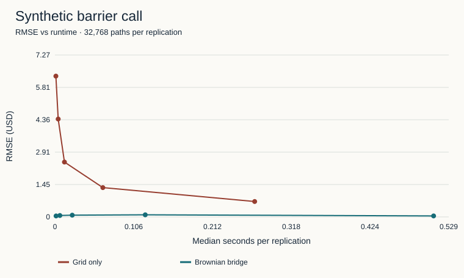

# Barrier Option Monte Carlo

How much does a time grid miss when a barrier is monitored continuously? The synthetic anchor is a one-year down-and-out call with spot and strike $100, barrier $95, annual volatility 25%, annual rate 3%, and zero dividend or rebate. The reflection formula values it at **$5.02942**. A separate continuous integral agrees to about three hundredths of a millionth of a dollar.



The grid-only estimator can miss a knockout when consecutive endpoints both survive. The bridge estimator weighs each path by the probability of staying above the barrier between its sampled endpoints. [Results and limitations](RESULTS.md) include the comparison against the separately defined 16-date discrete contract.





## Reproduce

Use Python 3.11–3.14. Create and activate a virtual environment if desired, then run from the repository directory.

```sh
git clone https://github.com/NeilMeher/barrier-option-monte-carlo.git
cd barrier-option-monte-carlo
python -m pip install -r requirements.txt
python -m unittest -v
python study.py --quick --output pilot
python study.py
```

The last command benchmarks both estimators, saves the three figures, and writes [estimates.csv](report/estimates.csv) and [benchmarks.txt](report/benchmarks.txt). Runtime measurements and the calibrated path counts vary by machine. Run the small seeded path and four-replication experiment with the quick command. No external data are required.

## Check the anchor with a calculator

Set x = ln(100/95) = 0.0512933, v = 0.25² = 0.0625, m = 0.03 − v/2 = −0.00125. With Φ the standard normal CDF, compute F(a) = 95 exp(a+v/2) Φ((a+v−x)/0.25) − 100 Φ((a−x)/0.25). Evaluate exp(−0.03) × [F(x+m) − exp(−2mx/v) F(−x+m)]. This gives about $5.02942. For a separate check, [study.py](study.py) integrates the terminal payoff with conditional survival directly.

## Design and credit

See the [frozen protocol](PROTOCOL.md), [source register and data dictionary](SOURCES.md), and [experiment log](EXPERIMENT.md). Neil Meher commissioned the research and set the verification and publication requirements. Codex implemented and ran it. Neil’s independent numerical check is pending.
